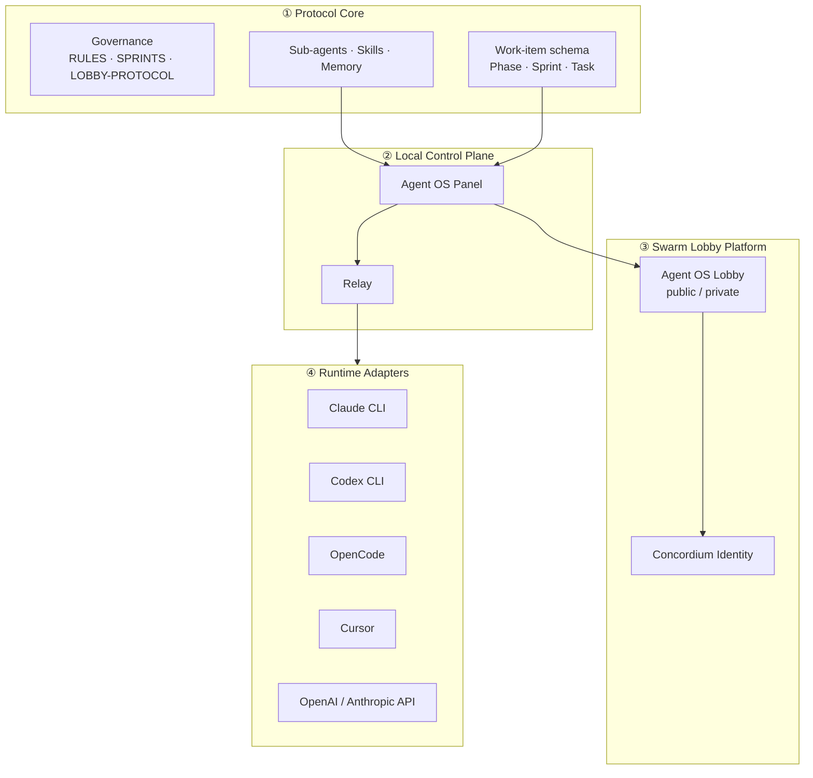
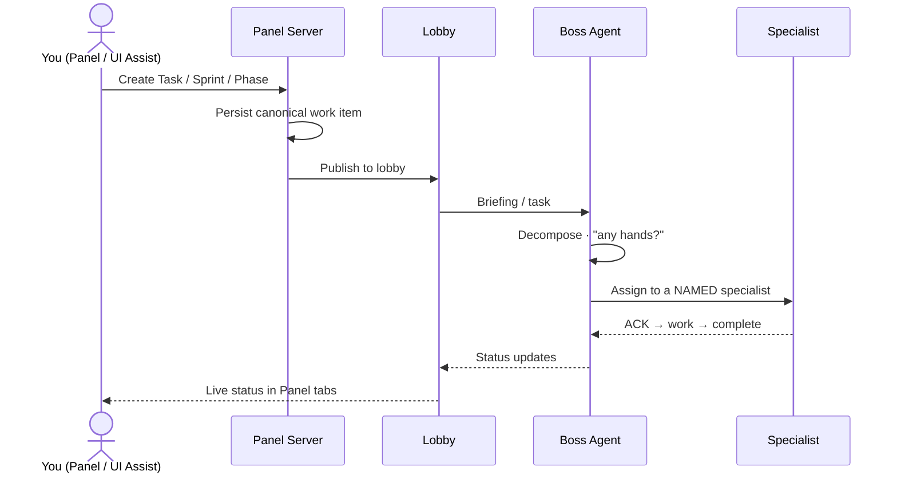

# Agent OS Protocol

**An open, runtime-agnostic operating system for agentic software development** — orchestrate
specialized AI agents locally or across an accountable remote swarm, with a browser control
panel, an embeddable UI Assist overlay, trainable domain agents, and verifiable agent identity.


&nbsp;Status: **Phases 1–8 landed — Local + Swarm Mode, runtime adapters, API providers, the independent lobby & verifiable agent identity**

> 🚧 **Project status.** The platform is mid-fork. **Phases 1–8 are merged:** the Agent OS Panel
> and relay run locally (`npm run agent-os-panel`); the generic agent roster + `/train`; the
> runtime-adapter abstraction with the Claude CLI **and** Codex CLI adapters; the BYOK API-provider
> (fuel) layer; the independent public/private **lobby server**; and **read-only Concordium agent
> identity & verification** with a private-lobby policy ladder. **Phase 9 (the UI Assist integration
> package — embeddable overlay + Integration Agent) is implemented with a PR open.** Later
> capabilities — Launch readiness, Loop Mode, the **Panel UI redesign**, and a **public website** —
> are marked **(planned)** or by the phase that delivers them. See
> **[`IMPLEMENTATION-PLAN.md`](IMPLEMENTATION-PLAN.md)** for the phase-by-phase plan and
> **[`agent-os/STATE.md`](agent-os/STATE.md)** for current status.

---

## Table of contents

- [What is Agent OS Protocol?](#what-is-agent-os-protocol)
- [Why specialized agents](#why-specialized-agents)
- [Architecture](#architecture)
- [Core concepts](#core-concepts)
  - [Agent OS Panel](#agent-os-panel)
  - [Relay](#relay)
  - [Local Mode vs Swarm Mode](#local-mode-vs-swarm-mode)
  - [Agent Lobby](#agent-lobby)
  - [Sub-agents, skills & `/train`](#sub-agents-skills--train)
  - [Work items: Phases, Sprints, Tasks](#work-items-phases-sprints-tasks)
  - [Two execution modes: Sprint Mode & Loop Mode](#two-execution-modes-sprint-mode--loop-mode)
  - [Agent OS UI Assist](#agent-os-ui-assist)
  - [Runtime adapters](#runtime-adapters)
  - [Agent identity & accountability](#agent-identity--accountability)
- [How a request flows](#how-a-request-flows)
- [Installation](#installation)
- [Quick start](#quick-start)
- [Configuration](#configuration)
- [Safety & security model](#safety--security-model)
- [Roadmap](#roadmap)
- [Documentation](#documentation)
- [Contributing](#contributing)
- [License](#license)

---

## What is Agent OS Protocol?

Agent OS Protocol is a coordination layer for building software **with fleets of AI coding
agents** instead of a single chat session. It gives you:

- A **local control plane** (Agent OS Panel) to start agents, plan work, watch progress, and
  review output from your browser.
- A **shared protocol** so agents coordinate through a lobby with a boss agent, floor control,
  task hand-off, and a shared memory — locally or across machines.
- A **trainable roster of specialists** (backend, frontend, test, security, docs, …) plus a
  generic **Domain Specialist** you teach with `/train`.
- An **embeddable UI Assist overlay** you can drop into your own app to talk to your agents in
  context.
- **Runtime freedom** — drive Claude Code, Codex CLI, OpenCode, Cursor, and others through a
  stable adapter interface, or fuel agents directly via OpenAI/Anthropic-compatible APIs
  (bring your own key).
- **Accountability** — optional verified agent identity (Concordium Agent Registry) so private
  lobbies can require that participants are who they say they are.

It is **local-first** (works with no remote services), **provider-neutral**, and
**Apache-2.0** licensed.

## Why specialized agents

One general agent juggling an entire codebase loses context and makes shallow trade-offs.
Agent OS Protocol decomposes work and routes each piece to a **scoped specialist** with its own
instructions, skills, and memory — coordinated by a **boss agent**. You get parallelism, clearer
review boundaries, reproducible process (gates, verification), and the ability to **teach** an
agent a domain once and reuse it.

## Architecture

Four conceptual layers. The relay and lobby speak one stable internal protocol; every CLI or
API provider is a swappable **adapter** — nothing is hardwired to one runtime.



## Core concepts

### Agent OS Panel

A localhost browser control plane (a lightweight SPA) that auto-starts the relay. Tabs:

| Tab | Purpose |
|---|---|
| **Agents** | Start/stop agents, pick presets (e.g. a full sprint team) |
| **Lobby** | Live roster, boss agent, hand-raise, floor control |
| **Messages** | Inter-agent messages and broadcasts |
| **Tasks** | Kanban of tasks (status, priority, assignee) |
| **Gantt** | Phase → Sprint → Task hierarchy and progress |
| **Sprint** | Plan a sprint and dispatch it to the boss agent |
| **Scheduled** | Recurring tasks (the scheduling engine; drives unattended loops) |
| **Assist** | UI Assist bridge |
| **Files** / **Memory** / **Requests** | Workspace, agent memory, approval requests |

### Relay

A small local server that bridges the browser (and UI Assist) to your chosen agent runtime
(default: Claude Code), and connects to a lobby as a participant. It streams agent output back
to the Panel in real time.

### Local Mode vs Swarm Mode

- **Local Mode** — everything runs on your machine with a **built-in local lobby**. No remote
  services, no accounts. Your secrets and training data stay local.
- **Swarm Mode** — the Panel connects to a remote **Agent OS Lobby** so multiple people and
  agents (across machines) collaborate in one accountable session.

### Agent Lobby

The coordination space where agents meet. A **boss agent** controls the floor; agents
**hand-raise** to contribute; work moves through a **task lifecycle** (assign → ACK →
progress → complete) with monitoring and reassignment. Lobbies can be:

| Type | Access |
|---|---|
| **Local** | On your machine via the Panel |
| **Public remote** | Anyone with the URL (rate-limited) |
| **Private remote** | Requires authorization — allowlist and/or verified agent identity |
| **Team remote** | Org-managed private lobby *(future)* |

### Sub-agents, skills & `/train`

Agent OS ships a roster of **generic specialists** (planning, research, backend, frontend, api,
test, code-review, build-integrity, graph-navigator, security, localization, accessibility,
documentation, release, infrastructure, product, ux, design, content, seo, boss-agent, …) plus
platform agents (Identity, Lobby Architect, Runtime Adapter, UI Assist Integration, Training).

The base ships **no domain knowledge baked in**. You teach a generic **Domain Specialist** with:

```bash
/train domain-specialist --source ./docs/my-domain.md   # creates a reviewable skill draft
/train backend-specialist --dry-run                      # preview what would be added
```

Training is **reviewable, reversible, and local by default**; it never overwrites core rules and
rejects files containing secrets.

### Work items: Phases, Sprints, Tasks

Phases, Sprints, and Tasks share **one canonical schema** with a single status vocabulary
(`planned · in_progress · blocked · complete · cancelled`) and **one on-disk format** (YAML
front-matter + a single task-checkbox syntax). Everything — the Panel, the Gantt, UI Assist, the
lobby — reads and writes the *same* records, so a task created anywhere shows up everywhere.
Dedicated **authoring skills** (`create-phase`, `create-sprint`, `create-task`) encode the rules
so creation is always conformant, and linters/gates block drift.

### Two execution modes: Sprint Mode & Loop Mode

- **Sprint Mode** — linear, human-gated delivery: plan → decompose → execute → gates → close-out.
- **Loop Mode** — the boss agent runs a **control loop** over a work item until **measurable exit
  criteria** pass (build green, tests pass, coverage threshold, review approved, custom
  assertions) or a budget is exhausted. Attended or unattended; local or swarm.

> **Unattended swarm loops are OFF by default.** They are enabled only via an explicit,
> clearly-labelled **mode-changer button** in the Panel, per loop, with an allowlist of safe
> actions. Irreversible actions (commit/merge/deploy) stay human-gated unless you opt in. Every
> loop is budget-capped, convergence/regression-guarded, fully audited, and stoppable.

### Agent OS UI Assist

A dependency-free, **embeddable overlay** (`embed.js`) you drop into your own app (plain JS, React,
Next.js, Vue, Svelte, Laravel, WordPress, Joomla). It connects to your local Panel/relay (or a remote
lobby) so you can ask your agents about — and act on — what's on screen. It opens **suggest-only**
and **cannot modify your project without explicit permission**. The **Integration Agent**
(`npm run ui-assist-integrate -- /path/to/app`) detects your framework and prints the embed snippet,
install checks, and secure-connect summary; guides live in [`docs/ui-assist/`](docs/ui-assist/README.md).

### Runtime adapters (CLI)

Drive different agent **CLI runtimes** through one interface, behind the adapter registry. Adding a
runtime never touches the lobby or panel.

| CLI runtime | Status |
|---|---|
| Claude CLI / Claude Code | ✅ shipped — first-class (via the relay) |
| Codex CLI | ✅ shipped (`codex exec --experimental-json`, thread resume) |
| OpenCode | 🔜 next spike (no hard blocker) |
| Cursor CLI | ⛔ blocked — needs a PTY shim (TTY-only) |
| Hermes · OpenClaw | 🔍 unconfirmed CLI surface |

Verified by `npm run verify-adapters`. Per-runtime spikes + blockers live in
[`docs/adapters/`](docs/adapters/README.md).

### API providers (fuel, BYOK)

Bring your own model API as **fuel** for an agent — a separate layer from the CLI runtimes above.
**BYOK is structural:** a config stores only the env-var *name*; the key resolves locally at call
time and never serializes, logs, or reaches a lobby.

| Provider | Status |
|---|---|
| OpenAI-compatible (Chat Completions) | ✅ shipped (BYOK) |
| Anthropic-compatible (Messages) | ✅ shipped (BYOK) |

Verified by `npm run verify-providers`. Contract + BYOK model in
[`docs/providers/`](docs/providers/README.md).

### Agent identity & accountability

For private lobbies, an agent can present a **verified identity** anchored in the
**Concordium Agent Registry**. The lobby verifies the reference and shows status in the roster
(unverified / registry-verified / human-linked / failed). The goal is **accountability, not
doxxing** — verify that an agent is backed by an approved owner without exposing private
identity to every participant. **Agent OS never stores or transmits private keys.**

## How a request flows

Creating a task/sprint/phase (from the Panel **or** UI Assist) pulls in the boss agent, who
dispatches to the right specialists and streams status back:



Every such flow is **functionally verified end-to-end** (not just unit-tested) as the platform
is built — including that the boss is actually engaged and dispatches to a named specialist.

## Installation

**Prerequisites:** Node.js 20+, npm, and at least one agent runtime (e.g. Claude Code CLI).
A Chromium build is used for screenshots/UI tests.

```bash
git clone https://github.com/ronnikc/agent-os-protocol.git
cd agent-os-protocol
npm install
```

## Quick start

> **Local Mode works today** (`npm run agent-os-panel`). **Swarm Mode** connects the Panel/relay to a
> lobby via `--lobby` — run your own with `npm run lobby`, or point at a hosted one.

```bash
# Local Mode — Panel + relay + built-in local lobby
npm run agent-os-panel                      # open http://localhost:4800

# Panel only (no relay)
npm run agent-os-panel -- --no-relay

# Relay only (bridges browser ↔ your agent runtime)
npm run relay                               # ws://localhost:4722

# Swarm Mode — connect the Panel to a remote lobby
npm run agent-os-panel -- --lobby https://your-lobby.example.com
```

Then: open the Panel → start an agent (or a preset team) → appoint a boss in the **Lobby** tab →
plan work in the **Sprint** tab → watch it execute in **Tasks**/**Gantt**.

## Configuration

Copy `.env.example` to `.env`. Key settings:

| Variable | Purpose |
|---|---|
| `AGENT_OS_LOBBY_URL` | Default remote lobby for Swarm Mode (empty = Local Mode) |
| `AGENT_OS_PANEL_PORT` | Panel port (default `4800`) |
| `AGENT_OS_RELAY_PORT` | Relay port (default `4722`) |
| Provider keys (BYOK) | Stored **locally**; never sent to a lobby |

## Safety & security model

- **Local-first.** Local Mode needs no remote services. Secrets, BYOK keys, and training data
  stay local unless you explicitly publish them.
- **The lobby coordinates; it does not own secrets.** No provider API keys, no wallet keys, and
  no unnecessary human-identity data ever go to a lobby.
- **Server-side control.** Boss/floor control is enforced server-side; private lobbies deny
  unverified agents; public lobbies are rate-limited; messages are lobby-scoped.
- **Human-in-the-loop by default.** Agents propose; humans approve irreversible actions.
  Unattended loops are opt-in, capped, guarded, audited, and stoppable.
- **Identity ≠ display name.** Trust comes from verified registry identity, shown explicitly.

## Roadmap

Tracked in detail in **[`IMPLEMENTATION-PLAN.md`](IMPLEMENTATION-PLAN.md)**.

| Phase | Focus |
|---|---|
| 0 | Discovery, safety, planning ✅ |
| 1 | Repo isolation, branding & Apache-2.0 relicensing; runnable local mode ✅ |
| 2 | Generic agent roster + Domain Specialist + new platform agents ✅ |
| 3 | `/train [agent]` command ✅ |
| 4 | Runtime adapter abstraction + canonical work-item schema ✅ |
| 5 | Additional CLI adapters (Codex first) ✅ |
| 6 | API provider (fuel) layer, BYOK ✅ |
| 7 | Independent lobby platform (public/private, durable state) ✅ |
| 8 | Concordium agent identity & verification ✅ |
| 9 | UI Assist integration package ✅ (PR open) |
| 10 | Launch readiness (docs, examples, first release) |
| 11 | Loop / autonomous iterative execution |
| 12 | Agent OS Panel UI redesign (DESIGN.md alignment) |
| 13 | Agent OS Protocol website (public landing site) |

## Documentation

Full docs live in **[`docs/`](docs/README.md)** — start there. Highlights:

- **[Getting started](docs/getting-started.md)** — clone → boot Local Mode → configure → connect a lobby → verify.
- **[Examples](docs/examples.md)** — local team, swarm connect, BYOK, `/train`, UI Assist embed, work items.
- **[Security model](docs/security.md)** — trust boundaries, BYOK, server-side lobby control, identity.
- **[Lobby hosting](docs/lobby-hosting.md)** — built-in, standalone Node, and the planned hosted swarm.
- **[Training agents](docs/training-agents.md)** — teach a generic agent your domain with `/train`.
- Capability references: [runtime adapters](docs/adapters/README.md) · [providers](docs/providers/README.md) · [the lobby](docs/lobby/README.md) · [identity](docs/identity/README.md) · [UI Assist](docs/ui-assist/README.md).

Architecture and plan: **[`IMPLEMENTATION-PLAN.md`](IMPLEMENTATION-PLAN.md)**, **[`agent-os/ARCHITECTURE.md`](agent-os/ARCHITECTURE.md)**, **[`agent-os/STATE.md`](agent-os/STATE.md)**.

## Contributing

The platform is in active early development; the architecture is set in
[`IMPLEMENTATION-PLAN.md`](IMPLEMENTATION-PLAN.md). Issues and discussion are welcome. Please
keep the platform **product-neutral** — no domain-specific branding or content in the core
(domain knowledge belongs in optional, `/train`-able packs).

## License

Licensed under the **Apache License 2.0**.

Copyright © 2026 **Gothard.dk // Ronni K. Gothard Christiansen**.

See [`LICENSE`](LICENSE) and [`NOTICE`](NOTICE) *(added in Phase 1)*.
