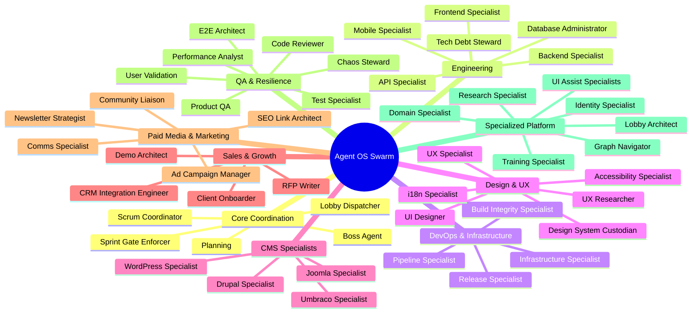

# Agent OS Protocol — Sub-Agents & Skills Catalog

This directory contains the definitions for the **Specialist Agents** and **Skills** that comprise the execution layer of the Agent OS Protocol. 

In a Swarm Lobby, the appointed **Boss Agent** (the local team leader) coordinates work by decomposing sprints into tasks, evaluating connected specialist capabilities, and routing assignments to specialized agents who raise their hands in the lobby.

---

## 1. Roster Divisions

The expanded roster is divided into 9 functional departments to represent a balanced, collaborative development swarm:

---

## 2. Specialist Agent Directory

Click on any agent's name to view its detailed definition, startup protocol, and core rules.

### Core Coordination & Governance
| Agent | Slug | Core Mission |
|:---|:---|:---|
| **[Boss Agent](agents/boss-agent.md)** | `boss-agent` | Coordinates the lobby, manages floor control, plans sprints, and assigns tasks. |
| **[Planning Specialist](agents/planning.md)** | `planning` | Translates sprints into technical implementation plans and scopes dependencies. |
| **[Sprint Gate Enforcer](agents/sprint-gate-enforcer.md)** | `sprint-gate-enforcer` | Enforces structural check gates before task commits and during sprint close-outs. |
| **[Lobby Dispatcher](agents/lobby-dispatcher.md)** | `lobby-dispatcher` | Monitors connected agent rosters and routes tasks matching specialist capabilities. |
| **[Scrum Coordinator](agents/scrum-coordinator.md)** | `scrum-coordinator` | Manages backlogs, tracks sprint velocities, and automates Gantt timelines. |

### Engineering & Core Architecture
| Agent | Slug | Core Mission |
|:---|:---|:---|
| **[Backend Specialist](agents/backend.md)** | `backend` | Implements backend data models, business logic, routes, and services. |
| **[Frontend Specialist](agents/frontend.md)** | `frontend` | Implements UI views, state management, interactive components, and styles. |
| **[API Specialist](agents/api.md)** | `api` | Designs, documents, and validates REST/WebSocket API contracts. |
| **[Mobile Specialist](agents/mobile-specialist.md)** | `mobile-specialist` | Adapts web pages, overlays, and relays to run inside hybrid mobile wrappers. |
| **[Database Administrator](agents/database-administrator.md)** | `database-administrator` | Audits migrations, queries, indexes, constraints, and database transactions. |
| **[Tech Debt Steward](agents/tech-debt-steward.md)** | `tech-debt-steward` | Identifies and refactors complex functions, duplicate imports, and dead code. |

### DevOps & Infrastructure
| Agent | Slug | Core Mission |
|:---|:---|:---|
| **[Infrastructure Specialist](agents/infrastructure.md)** | `infrastructure` | Manages environment configurations, Docker builds, CORS, and servers. |
| **[Release Specialist](agents/release.md)** | `release` | Audits release branch stability, compiles changelogs, and drafts release tags. |
| **[Build Integrity Specialist](agents/build-integrity.md)** | `build-integrity` | Validates TypeScript compilations, resolves import issues, and checks build maps. |
| **[Pipeline Specialist](agents/pipeline-specialist.md)** | `pipeline-specialist` | Manages CI/CD configurations, caching keys, build steps, and run logs. |
| **[Security Specialist](agents/security.md)** | `security` | Hardens system boundaries, triages package vulnerabilities, and audits RBAC. |

### Design, UX, & Interface
| Agent | Slug | Core Mission |
|:---|:---|:---|
| **[UI Designer](agents/design.md)** | `design` | Develops style guides, visual assets, SVG symbols, and CSS component tokens. |
| **[UX Specialist](agents/ux.md)** | `ux` | Audits layout flows, responsive behaviors, interactive feedback, and copy. |
| **[Accessibility Specialist](agents/accessibility.md)** | `accessibility` | Implements ARIA patterns, focus visible states, and verifies WCAG 2.1 AA. |
| **[Design System Custodian](agents/design-system-custodian.md)** | `design-system-custodian` | Audits styling files for variable compliance, color contrast, and token reuse. |
| **[i18n Specialist](agents/i18n-specialist.md)** | `i18n-specialist` | Manages translation catalogs, currency/date formats, and localization hooks. |
| **[UX Researcher](agents/ux-researcher.md)** | `ux-researcher` | Audits telemetry click-flows and user interface navigation friction. |

### CMS Specialists
| Agent | Slug | Core Mission |
|:---|:---|:---|
| **[WordPress Specialist](agents/wordpress-specialist.md)** | `wordpress-specialist` | Designs Gutenberg blocks, themes, and audits custom plugin integration codes. |
| **[Drupal Specialist](agents/drupal-specialist.md)** | `drupal-specialist` | Configures module hooks, dynamic queries, routes, and Twig template files. |
| **[Joomla! Specialist](agents/joomla-specialist.md)** | `joomla-specialist` | Integrates component layouts, module views, and verifies MVC form tokens. |
| **[Umbraco Specialist](agents/umbraco-specialist.md)** | `umbraco-specialist` | Configures ASP.NET controllers, Razor templates, and composer event handlers. |

### Sales & Growth
| Agent | Slug | Core Mission |
|:---|:---|:---|
| **[Demo Architect](agents/demo-architect.md)** | `demo-architect` | Creates mock integration sandboxes and playgrounds to showcase system features. |
| **[RFP Writer](agents/rfp-writer.md)** | `rfp-writer` | Analyzes client questionnaires, specifications, and compiles technical proposals. |
| **[Client Onboarder](agents/client-onboarder.md)** | `client-onboarder` | Generates custom integration plans, environment files, and onboarding packages. |
| **[CRM Integration Engineer](agents/crm-integration-engineer.md)** | `crm-integration-engineer` | Configures webhooks, payload schemas, and CRM data sync (HubSpot, Salesforce). |

### Paid Media & Marketing
| Agent | Slug | Core Mission |
|:---|:---|:---|
| **[Ad Campaign Manager](agents/ad-campaign-manager.md)** | `ad-campaign-manager` | Audits conversion pixel setups, UTM parameters, and CPC/ROAS thresholds. |
| **[SEO Link Architect](agents/seo-link-architect.md)** | `seo-link-architect` | Verifies domain authority parameters, organic link structures, and sitemaps. |
| **[Newsletter Strategist](agents/newsletter-strategist.md)** | `newsletter-strategist` | Designs responsive localized email templates and automated double opt-in flows. |
| **[Comms Specialist](agents/comms-specialist.md)** | `comms-specialist` | Translates technical commit logs and completed PRs into newsletters and blogs. |
| **[Community Liaison](agents/community-liaison.md)** | `community-liaison` | Monitores forums and discussion boards, triaging questions and drafting answers. |

### QA, Testing, & Resilience
| Agent | Slug | Core Mission |
|:---|:---|:---|
| **[Product QA](agents/product-qa.md)** | `product-qa` | Validates features against acceptance criteria, using smoke test cycles. |
| **[Test Specialist](agents/test.md)** | `test` | Implements unit and integration test specs, enforcing code coverage metrics. |
| **[User Validation](agents/user-validation.md)** | `user-validation` | Executes end-to-end integration flows and checks usability criteria. |
| **[Code Reviewer](agents/code-review.md)** | `code-review` | Critiques code quality, naming compliance, and checks straggler code. |
| **[E2E Architect](agents/e2e-architect.md)** | `e2e-architect` | Authors and runs browser end-to-end integration test suites (Playwright/Cypress). |
| **[Performance Analyst](agents/performance-analyst.md)** | `performance-analyst` | Conducts API load testing, monitors memory leaks, and benchmark timings. |
| **[Chaos Steward](agents/chaos-steward.md)** | `chaos-steward` | Injects mock endpoint latencies and service outages to audit resilience. |

### Specialized Platform Tools
| Agent | Slug | Core Mission |
|:---|:---|:---|
| **[Domain Specialist](agents/domain-specialist.md)** | `domain-specialist` | Trainable agent that learns codebase-specific domain knowledge via `/train`. |
| **[Identity Specialist](agents/identity.md)** | `identity` | Manages agent cards, hashes profile data, and interfaces with Concordium. |
| **[Training Specialist](agents/training.md)** | `training` | Processes source docs, strips secrets, and outputs custom agent training packs. |
| **[Lobby Architect](agents/lobby-architect.md)** | `lobby-architect` | Manages lobby configurations, durability stores, and serverless transports. |
| **[Research Specialist](agents/research.md)** | `research` | Performs read-only codebase searches, impact analyses, and root-cause tracing. |
| **[Graph Navigator](agents/graph-navigator.md)** | `graph-navigator` | Resolves complex system graphs, type paths, and module dependencies. |
| **[UI Assist Specialist](agents/ui-assist.md)** | `ui-assist` | Integrates overlay hooks, mounts scripts, and configures event contracts. |
| **[UI Assist Integration](agents/ui-assist-integration.md)** | `ui-assist-integration` | Detects framework environments and outputs tailored integration plans. |
| **[Content Specialist](agents/content.md)** | `content` | Authors public facing copy, email briefs, and technical landing assets. |
| **[SEO Specialist](agents/seo.md)** | `seo` | Audits page speed, viewport tags, schema markup, and metadata. |

---

## 3. Developer Skills Index

Agent OS Protocol codifies complex, repetitive developer actions as **Skills** stored in the [skills/](skills/README.md) subdirectory. Each skill features structured step-by-step workflows, input/output Zod schemas, quality gates, and error handlers.

### Engineering & Implementation
- **[sprint-decomposition](skills/sprint-decomposition/SKILL.md):** Decomposes sprint objectives into ordered, specialist-routed tasks.
- **[implementation-planning](skills/implementation-planning/SKILL.md):** Drafts detailed step-by-step TDD implementation plans.
- **[source-driven-development](skills/source-driven-development/SKILL.md):** Grounds decisions in official local framework docs, preventing hallucinations.
- **[incremental-implementation](skills/incremental-implementation/SKILL.md):** Builds code in roll-back friendly, thin vertical slices.
- **[service-pattern](skills/service-pattern/SKILL.md) & [component-pattern](skills/component-pattern/SKILL.md):** Enforces canonical backend service and frontend component templates.
- **[database-migration-audit](skills/database-migration-audit/SKILL.md):** Audits schema changes, query indexing, constraints, and rollbacks.

### Quality Assurance & Verification
- **[verification-gate](skills/verification-gate/SKILL.md):** Requires execution evidence (compile, test, lint outputs) before completing tasks.
- **[tdd-discipline](skills/tdd-discipline/SKILL.md):** Enforces write-failing-test-first Red-Green-Refactor development.
- **[root-cause-debugging](skills/root-cause-debugging/SKILL.md):** Guides systematic tracing of bugs before modifying any code.
- **[code-review-and-quality](skills/code-review-and-quality/SKILL.md):** Audits code along 5 core axes (Correctness, Readability, Architecture, Security, Performance).
- **[security-and-hardening](skills/security-and-hardening/SKILL.md):** Checks security patterns against OWASP Top 10 vulnerabilities.
- **[performance-optimization](skills/performance-optimization/SKILL.md):** Measures Core Web Vitals, index coverage, and bundle budgets.
- **[chaos-testing](skills/chaos-testing/SKILL.md):** Injects endpoint latency and process shutdowns to verify failure recovery.

### Swarm & Loop Coordination
- **[loop-orchestrator](skills/loop-orchestrator/SKILL.md):** Controls loops, tracking convergence criteria and budget metrics.
- **[create-loop](skills/create-loop/SKILL.md):** Authors loops with measurable exit criteria and budget limits.
- **[task-routing](skills/task-routing/SKILL.md):** Routes tasks to qualified specialists connected in the lobby.
- **[identity-verification](skills/identity-verification/SKILL.md):** Audits and resolves agent identities against the Concordium registry.

### Release & Delivery
- **[deployment-verification](skills/deployment-verification/SKILL.md):** Runs health checks, HSTS checks, and security audits post-deployment.
- **[release-checklist](skills/release-checklist/SKILL.md):** Validates release parameters before tag generation.
- **[release-notes](skills/release-notes/SKILL.md):** Auto-compiles changelogs matching functional sprint criteria.
- **[documentation-and-adrs](skills/documentation-and-adrs/SKILL.md):** Records architectural choices as standardized ADRs.
- **[pipeline-configuration](skills/pipeline-configuration/SKILL.md):** Verifies CI/CD workflow actions, hash caching keys, and runner syntax.

### Content & Growth
- **[cms-plugin-integration](skills/cms-plugin-integration/SKILL.md):** Audits custom hooks, hook priority filters, and XML manifests.
- **[campaign-metric-audit](skills/campaign-metric-audit/SKILL.md):** Computes CAC, ROAS metrics, conversion tags, and UTM attribution parameters.

*For the complete detailed skills registry, see the [Skills Registry Index](skills/README.md).*
