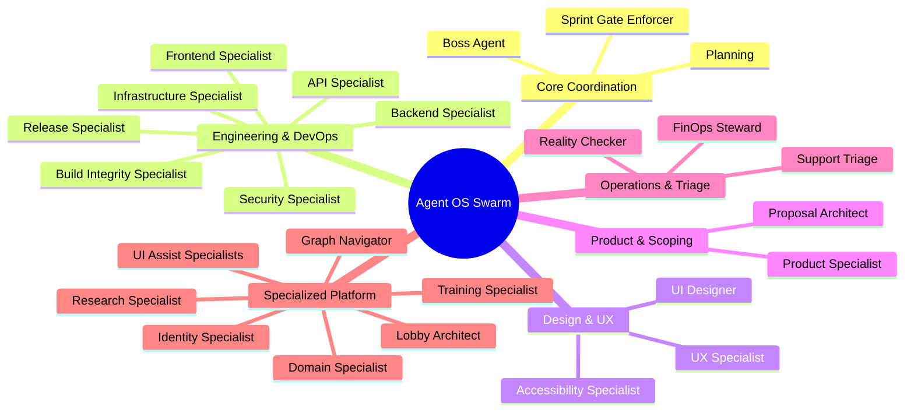

# Agent OS Protocol — Sub-Agents & Skills Catalog

This directory contains the definitions for the **Specialist Agents** and **Skills** that comprise the execution layer of the Agent OS Protocol. 

In a Swarm Lobby, the appointed **Boss Agent** (the local team leader) coordinates work by decomposing sprints into tasks, evaluating the capabilities of connected specialists, and routing assignments to specialized agents who raise their hands to contribute.

---

## 1. Roster Divisions

The roster is divided into 6 functional areas to mirror a balanced software development organization:

---

## 2. Specialist Agent Directory

Click on any agent's name to view its detailed definition, startup protocol, and core rules.

### Core Coordination & Governance
| Agent | Slug | Core Mission |
|:---|:---|:---|
| **[Boss Agent](agents/boss-agent.md)** | `boss-agent` | Coordinates the lobby, manages floor control, plans sprints, and assigns tasks. |
| **[Planning Specialist](agents/planning.md)** | `planning` | Translates sprints into technical implementation plans and scopes dependencies. |
| **[Sprint Gate Enforcer](agents/sprint-gate-enforcer.md)** | `sprint-gate-enforcer` | Enforces structural check gates before task commits and during sprint close-outs. |

### Engineering & DevOps
| Agent | Slug | Core Mission |
|:---|:---|:---|
| **[Backend Specialist](agents/backend.md)** | `backend` | Implements data models, business logic, routing, and controller services. |
| **[Frontend Specialist](agents/frontend.md)** | `frontend` | Implements UI views, state management, interactive components, and styles. |
| **[API Specialist](agents/api.md)** | `api` | Designs, documents, and validates REST/WebSocket API contracts. |
| **[Infrastructure Specialist](agents/infrastructure.md)** | `infrastructure` | Manages environment setup, Docker builds, CORS, security headers, and servers. |
| **[Release Specialist](agents/release.md)** | `release` | Audits release branch stability, compiles changelogs, and drafts release tags. |
| **[Build Integrity Specialist](agents/build-integrity.md)** | `build-integrity` | Validates TypeScript compilations, resolves import issues, and checks build maps. |
| **[Security Specialist](agents/security.md)** | `security` | Hardens system boundaries, triages package vulnerabilities, and audits RBAC. |

### Design, UX, & Accessibility
| Agent | Slug | Core Mission |
|:---|:---|:---|
| **[UI Designer](agents/design.md)** | `design` | Develops style guides, visual assets, SVG symbols, and CSS component tokens. |
| **[UX Specialist](agents/ux.md)** | `ux` | Audits layout flows, responsive behaviors, interactive feedback, and copy. |
| **[Accessibility Specialist](agents/accessibility.md)** | `accessibility` | Implements ARIA patterns, focus visible states, and verifies WCAG 2.1 AA. |

### Product & Scoping
| Agent | Slug | Core Mission |
|:---|:---|:---|
| **[Product Specialist](agents/product.md)** | `product` | Manages functional requirements, sprint criteria, and user personas. |
| **[Proposal Architect](agents/proposal-architect.md)** | `proposal-architect` | Scopes high-level ideas/pitches into sprint backlogs and task queues. |

### Operations, Critique, & Triage
| Agent | Slug | Core Mission |
|:---|:---|:---|
| **[Support Triage](agents/support-triage.md)** | `support-triage` | Triages user bug reports and system logs into hotfix specs for developers. |
| **[FinOps Steward](agents/finops-steward.md)** | `finops-steward` | Monitors token burn rates and API costs to optimize execution budgets. |
| **[Reality Checker](agents/reality-checker.md)** | `reality-checker` | Serves as the independent critic, auditing assumptions and finding edge-case risks. |

### Specialized Platform Tools
| Agent | Slug | Core Mission |
|:---|:---|:---|
| **[Domain Specialist](agents/domain-specialist.md)** | `domain-specialist` | Trainable agent that learns codebase-specific domain knowledge via `/train`. |
| **[Identity Specialist](agents/identity.md)** | `identity` | Manages agent cards, hashes profile data, and interfaces with Concordium. |
| **[Training Specialist](agents/training.md)** | `training` | Processes source docs, strips secrets, and outputs custom agent training packs. |
| **[Lobby Architect](agents/lobby-architect.md)** | `lobby-architect` | Manages lobby configurations, durability stores, and serverless transports. |
| **[Research Specialist](agents/research.md)** | `research` | Performs read-only codebase searches, impact analyses, and root-cause tracing. |
| **[Graph Navigator](agents/graph-navigator.md)** | `graph-navigator` | Resolves complex system graphs, type paths, and module dependencies. |
| **[UI Assist Specialist](agents/ui-assist.md)** | `ui-assist` | Integrates overlay hooks, mounts scripts, and configures event contracts. |
| **[UI Assist Integration](agents/ui-assist-integration.md)** | `ui-assist-integration` | Detects framework environments and outputs tailored integration plans. |
| **[User Validation Specialist](agents/user-validation.md)** | `user-validation` | Executes end-to-end integration flows and checks usability criteria. |
| **[Code Review Specialist](agents/code-review.md)** | `code-review` | Critiques code quality, naming compliance, and checks straggler code. |
| **[Content Specialist](agents/content.md)** | `content` | Authors public facing copy, email briefs, and technical landing assets. |
| **[SEO Specialist](agents/seo.md)** | `seo` | Audits page speed, viewport tags, schema markup, and metadata. |

---

## 3. Developer Skills Index

Agent OS Protocol codifies complex, repetitive developer actions as **Skills** stored in the [skills/](skills/README.md) subdirectory. Each skill features structured step-by-step workflows, input/output Zod schemas, quality gates, and error handlers.

### Engineering & Implementation
- **[sprint-decomposition](skills/sprint-decomposition/SKILL.md):** Decomposes sprint objectives into ordered, specialist-routed tasks.
- **[implementation-planning](skills/implementation-planning/SKILL.md):** Drafts detailed step-by-step TDD implementation plans.
- **[source-driven-development](skills/source-driven-development/SKILL.md):** Grounds decisions in official local framework docs, preventing hallucinations.
- **[incremental-implementation](skills/incremental-implementation/SKILL.md):** Builds code in roll-back friendly, thin vertical slices.
- **[service-pattern](skills/service-pattern/SKILL.md) & [component-pattern](skills/component-pattern/SKILL.md):** Enforces canonical backend service and frontend component templates.

### Quality Assurance & Verification
- **[verification-gate](skills/verification-gate/SKILL.md):** Requires execution evidence (compile, test, lint outputs) before completing tasks.
- **[tdd-discipline](skills/tdd-discipline/SKILL.md):** Enforces write-failing-test-first Red-Green-Refactor development.
- **[root-cause-debugging](skills/root-cause-debugging/SKILL.md):** Guides systematic tracing of bugs before modifying any code.
- **[code-review-and-quality](skills/code-review-and-quality/SKILL.md):** Audits code along 5 core axes (Correctness, Readability, Architecture, Security, Performance).
- **[security-and-hardening](skills/security-and-hardening/SKILL.md):** Checks security patterns against OWASP Top 10 vulnerabilities.
- **[performance-optimization](skills/performance-optimization/SKILL.md):** Measures Core Web Vitals, index coverage, and bundle budgets.

### Swarm & Loop Coordination
- **[loop-orchestrator](skills/loop-orchestrator/SKILL.md):** Controls loops, tracking convergence criteria and budget metrics.
- **[create-loop](skills/create-loop/SKILL.md):** Authors loops with measurable exit criteria and budget limits.
- **[task-routing](skills/task-routing/SKILL.md):** Routes tasks to qualified specialists connected in the lobby.
- **[identity-verification](skills/identity-verification/SKILL.md):** Audits and resolves agent identities against the Concordium registry.

### Release & Delivery
- **[deployment-verification](skills/deployment-verification/SKILL.md):** Runs health checks, HSTS checks, and security audits post-deployment.
- **[release-checklist](skills/release-checklist/SKILL.md):** Validates release parameters before tag generation.
- **[release-notes](skills/release-notes/SKILL.md):** Auto-compiles changelogs matching functional sprint criteria.
- **[documentation-and-adrs](skills/documentation-and-adrs/SKILL.md):** Records architectural choices as standardized ADRs.

*For the complete detailed skills registry, see the [Skills Registry Index](skills/README.md).*
