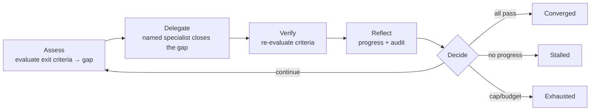

<!-- SPDX-License-Identifier: Apache-2.0 -->
<!-- Copyright (c) 2026 R Digital -->

# Loop Mode

**Loop Mode** lets the boss agent run a work item as a **control loop** — iterating until measurable
exit criteria pass, or a hard cap / budget stops it. It complements (does not replace) Sprint Mode:
both share the one work-item schema and the same gate skills.

- **Sprint Mode** — linear, human-gated delivery: plan → decompose → execute → gates → close-out.
- **Loop Mode** — `Assess → Delegate → Verify → Reflect → Decide`, repeated until the loop's
  `exitCriteria` all pass (converged), or `maxIterations` / `budget` is reached.

> **Try it now (simulated):**
> ```bash
> npm run loop -- --list
> npm run loop -- --preset continuous-quality
> npm run loop -- --preset continuous-quality --unattended
> ```
> This runs the real engine against deterministic in-process seams (no LLM/lobby) and prints the
> iteration trail — proving the spec + engine + safety model end-to-end.

## The `LoopSpec`

A loop attaches to a sprint (`Sprint.loop`). Authored with the **`create-loop`** skill; the
canonical type lives in `@agent-os/protocol-core`:

```ts
LoopSpec {
  goal: string                         // the converged state, in one sentence
  exitCriteria: ExitCriterion[]        // ALL must pass to converge (≥1, machine-checkable)
  maxIterations: number                // hard cap — no infinite loops
  budget?: { tokens?; wallClockMin?; costUSD? }
  strategy?: 'fix-forward' | 'tdd' | 'review-driven' | 'custom'
  approvalCheckpoints?: ('commit'|'merge'|'deploy'|'scope-change')[]  // human-gated by default
  unattended?: boolean                 // OFF by default — opt-in at run time, never bypasses a gate
  onConverge?: 'stop' | 'handoff' | 'open-pr'
  onExhaust?: 'stop-and-report' | 'escalate-to-human'
}

ExitCriterion =
  | { type: 'gate'; skill: string; threshold? }     // a gate skill (build-validation, coverage-enforcement, …)
  | { type: 'tests'; mustPass: true }
  | { type: 'review'; approver: string }            // code-review / product-qa / human
  | { type: 'assertion'; expr: string }             // custom, machine-checkable
```

> **"Until perfection" must be operationalized.** A loop converges only on **machine-checkable**
> criteria. If you can't state a check a machine can run, it isn't an exit criterion — use a
> `review` criterion with a human approver instead. The engine rejects a spec with no goal, no
> criteria, or a non-positive `maxIterations`.

## One iteration



The boss supplies the two seams: **evaluate** (run the gate skills / tests / review) and
**delegate** (dispatch to a *named* specialist with an ACK — never a broadcast). The engine
(`@agent-os/loop`) does everything else.

## Safety (enforced by the engine — verified by `npm run verify-loop`)

- **Hard caps** — `maxIterations` + token/cost/wall-clock `budget`; on overrun the loop stops and
  reports (`exhausted`).
- **Convergence + stall** — converges only when *all* criteria pass; stops after the stall window of
  no-progress iterations (`stalled`) to prevent churn.
- **Regression guard** — never adopts an iteration that flips a previously-passing criterion to
  failing (the result is rejected, not applied).
- **Approval checkpoints** — `commit` / `merge` / `deploy` / `scope-change` stay **human-gated by
  default**; without an approver the loop pauses `awaiting_checkpoint` (fail-closed).
- **Unattended OFF by default** — a `LoopSpec.unattended` request takes effect only when an operator
  opts in at run time (the Panel's per-loop mode-changer), and even then only **allowlisted** actions
  auto-approve; everything else still pauses.
- **Kill switch + audit** — checked every iteration; every event is emitted to a durable sink, so a
  loop is always stoppable and fully auditable.
- **Swarm** — unattended swarm loops additionally require verified identities in a private lobby
  ([identity](identity/README.md)).

## Running a loop

| Context | How |
|---|---|
| **Try it (simulated)** | `npm run loop -- --preset continuous-quality [--unattended]` — engine + spec, deterministic seams |
| **Real, in a session** | The boss runs the **`loop-orchestrator`** skill: `evaluate` wired to the gate skills, `delegate` to the lobby. Author the spec first with **`create-loop`**. |
| **Unattended / scheduled** | The scheduler triggers a preset loop on a cadence — see _Deferred_ below. |

## The first shipped preset: continuous-quality

The recurring "keep the codebase green and production-ready" workload (the Scheduled-QA system) is
expressed as the **`continuous-quality`** preset — the canonical example of a *deliberately-operated
unattended* loop:

- **Exit criteria:** `build-validation` gate · tests pass · `coverage-enforcement ≥ 80` · a
  `product-qa` review.
- **Caps:** `maxIterations: 5`, `budget: { wallClockMin: 60 }`.
- **Checkpoints:** all four gated; **`onConverge: open-pr`** — it opens a PR for a human, it never
  merges or deploys autonomously.
- **Unattended:** declares `unattended: true` but with a **tight allowlist of only `commit`** (to a
  fix branch). `merge` / `deploy` always stay human — and it still runs unattended only when the
  operator opts in.

## Deferred (infra-gated)

The engine, skills, preset, and simulated runner ship and are verified now. These need running
infrastructure and are tracked in [`agent-os/STATE.md`](../agent-os/STATE.md):

- **Live execution wiring** — binding `evaluate` to the real gate-skill runs and `delegate` to the
  Boss/lobby turn loop (rides on the relay-driver refactor).
- **Unattended cron** — the scheduler driving a preset loop on a cadence over a remote swarm with
  cost budgets and verified identities.
- **Panel Loop view** — start/pause/stop, per-criterion pass/fail, budget burn, approve-checkpoint,
  and the attended⇄unattended mode-changer (the backend loop endpoints land first; the polished UI
  is part of the Panel redesign, Phase 12).

---

Licensed under **Apache-2.0** · © 2026 R Digital.
