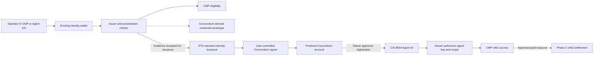

<!-- SPDX-License-Identifier: Apache-2.0 -->

# Phase 3 — Wallet onboarding, Agent ID, and delegated access

**Status** — Draft for owner review, 17 November 2026. All implementation and upstream PRs below are proposed. The owner will review the plan and separately authorize the Agent OS documentation PR. Keep the plan, sprint specs, draft partner brief, and upstream PR outlines in this repository during review.

[Product flows and contracts](product-contracts.md) · [Pilot contract and conformance gates](pilot-contract.md) · [Cross-repo PR delivery plan](delivery.md) · [Draft proposal for Concordium and DTS](partner-proposal.md)

[Risk and gaps register](risk-and-gaps-register.md) · [rCuK design](rcuk-design.md) · [DTS decisions](dts.md) · [Concordium upstream PR specs](concordium.md) · [AesirX CMP PR specs](aesirx-cmp.md)

[Origin-ID device and recovery design](origin-id-lifecycle.md) defines the same-account product outcome, current credential constraints, proposed native recovery authority, continuity discovery, races, fees and cross-repo delivery.

The [origin-ID wallet lifecycle](rcuk-design.md#origin-id-recovery-target) is part of the native onboarding product goal. A user who creates a Concordium account with EUDI, Google Wallet or Apple Wallet should be able to reuse that origin identity to add a device or recover the same account without manually handling a seed phrase or private key. [Sprint 3.1.2](sprint-3.1.2.md) proves those journeys independently. Sprint 3.1.1 remains the retained-factor reference. Supported profiles and real recovery require approved continuity evidence and an enforceable account-authorization model.

## Release objective

**Native onboarding.** A user brings an ID from EUDI Wallet, Google Wallet or Apple Wallet and completes native Concordium enrollment with one approval in the existing wallet on supported profiles. DTS issues the standard identity object, and a user-controlled signer deploys the account. Target a happy path with no forced Concordium ID App install or repeated identity capture. [3.1.3](sprint-3.1.3.md) tests a first-time CMP visitor in a fresh browser with no additional signer installation and supplies the install-free signer candidate. Show signer setup or issuer step-up and count every prompt. The owner separately approves registering or linking a CIS-8004 Agent ID from CMP. Pilot one EUDI PID profile first and bring Google and Apple issuance candidates to DTS with real profile evidence.

**Concordium-derived ID.** Carry forward the concept of deriving narrowly scoped, verifiable credentials from a trusted external wallet. Prototype issuance and verification with Concordium Web3 ID and CIS-4 as the candidate status registry. Test what the holder and verifier can actually do and whether the credential adds value to native issuance or CMP verification. A proof-only user can still complete an eligible CMP check. Native account creation and CIS-8004 ownership stay on the approved Concordium path.

**Origin-ID lifecycle and rCuK reference.** Sprint 3.1.2 targets adding devices and recovering the original account using the enrolled identity after every original device and personal recovery factor is lost. Prepare a recovery-only native authority proposal where existing account rules cannot enforce the required key replacement. Verify signing, promised identity-proof readiness, old-device revocation and the same Agent ID independently. Sprint 3.1.1 supplies the separately approved retained-factor backup prototype on the existing protocol. Both avoid manual seed/private-key handling. Each has its own evidence and production approval. [Origin-ID design](origin-id-lifecycle.md) · [Retained-factor contract](product-contracts.md#rcuk-recovery-contract)

**CMP and Agent OS.** AesirX CMP registers and links Agent IDs, accepts scoped agent credentials, and lets the agent relay the user's recorded consent decision or request a new human approval. x401 carries proof to the controller's authorization checks, and x402 handles any independently approved charge. An owner-installed AesirX CMP App, integration agent and skills make installation and management available to Agent OS projects in hosted and local modes.

**Minimum pilot.** Complete the existing-protocol journey on a JavaScript reference site: a local test issuer and separate user-controlled signer, finalized Agent ID from CMP, App installation, and a signed x401 consent flow with three separately authorized people and their agents in one lobby. Verify consent-before-tracking and one independently reconciled x402 test payment. Verify WordPress before enabling the plugin and run one DTS-approved EUDI PID profile before enabling real native issuance. Google/Apple expansion, the derived-credential example, broader external key proofs and the consensus sprint have separate gates.

### Decisions from the earlier onboarding proposals

Phase 3 builds on the owner's multi-year proposals for using identity credentials people already hold, including the CuK and Concordium onboarding drafts from around 2025. The table records the concepts carried forward. Validate historical wallet coverage, issuance schemas and sync assumptions against the selected current deployments.

| Prior proposal | Phase 3 decision |
| --- | --- |
| Resolving User Onboarding for Concordium | Make native issuance from an existing wallet an explicit option in CMP and Agent OS. Measure prompts, time, completion and repeat document capture against the existing onboarding path with DTS. |
| CuK-Derived ID on Concordium’s on-chain ZKP | Adopt context binding and short-lived, minimally disclosing proofs. Start with single-use server challenges and an expiring relying-party session. Explore scoped pseudonyms only for a demonstrated continuity requirement with reviewed cryptography. |
| CuK Accountability ID Layer | Keep event-scoped audit evidence and record the issuing policy and applicable status version. Treat public commitments, threshold opening and a separate external-wallet identity escrow as separate designs requiring a concrete use case, privacy review and partner approval. |
| Account Creation, Identity Data Propagation and Effective Sync Time | Separate issuer turnaround, chain finality and observability at the serving node or verifier. Measure them independently on pinned builds. Investigate HotSync or a dedicated propagation path only if contemporary measurements establish a gap and Concordium confirms its cause. |
| ID-Anchored Seed Recovery | Use origin identity to authorize device enrollment and same-account recovery. Specify the missing native recovery authority and private issuer continuity. Keep the retained-factor backup reference independently testable. Generate secrets randomly inside the signer and capability-gate official-wallet import and native rotation. |

### User validation targets

| Persona | Job to complete | Acceptance evidence |
| --- | --- | --- |
| First-time operator with an existing identity wallet | Start in CMP, approve in their existing wallet, return to an account they control, review and authorize their agent registration | A fresh browser/mobile run with prompts counted, recovery instructions exercised, and account and agent records independently verified |
| User with no Concordium account | Verify eligibility with their existing wallet, or opt into native issuance | The site verifies only the claims needed for the action. A separate Concordium-derived credential prototype tests issuer policy and wallet support. |
| Existing Concordium operator | Connect an account, use the ID App or wallet for a supported proof, and register or link an agent | Existing account and agent still resolve, with no duplicate mint on retry |
| Operator adding a device | Reuse the enrolled origin identity to authorize a new signer | Both devices use the original account and Agent ID. Individual device revocation has verified on-chain effect. |
| Operator who lost every enrolled device | Reuse a fresh or reissued same-person credential to regain the original account and Agent ID | No original device, kit or exported key. Verify replacement authority, old-device rejection and promised identity-proof readiness. |
| Operator using the retained-factor reference | Restore the test account with the enrolled user factor and find the existing Agent ID | Clean installation, independent chain readback, and stale grants kept disabled until reauthorized |
| Cross-chain agent operator | Keep the Ethereum, Solana, or EVM smart wallet they already use and demonstrate its link to the Concordium registration | Independent registry and external-chain verification, including the effect of a key or Safe owner change |
| Website operator and user authorizing an agent | Install CMP, link an Agent ID, and authorize the agent to relay a specific human choice | Clean JS and WordPress installs, trace of user choice and agent execution, identical retry, changed-purpose denial, and withdrawal effective at the site |
| Agent and its operator | Request a protected resource and optionally pay within explicit limits | Hosted and local runs, independently verified access, and one reconciled settlement for one approved purchase |
| DTS and Concordium reviewers | Reproduce issuance, verify the security and assurance controls, and decide whether any network change is justified | Versioned source, repeatable runbook, threat model, test vectors, and recorded availability and approval decisions |

## Phase 2 and the PLL release window

[Phase 2](../agent-wallets-and-payments-plan.md) owns the marketplace, spending controls, x402 settlement and Sprint 7 escrow lifecycle. **Phase 2 PLL escrow remains pending on the supporting Concordium network upgrade and end-to-end verification.** Phase 3 uses the existing Agent ID credential profile and immediate x402 settlement. See the [commerce evidence and remaining release checks](../http-proofs-and-payments.md).

Concordium's October update targets **27 January 2027** for PLL. The roadmap describes **Simple PLL** in January and **Enhanced PLL** in March. Confirm the actual protocol build, activation, asset types, authorization model and operations available on the selected network. Use the SDK work already in progress as a baseline. A branch, PR, tag, testnet feature, and finalized mainnet activation are different evidence. Phase 2 must verify the supported lock, release, expiry and recovery behavior before enabling escrow. Treat custom approvals, cancellation, dispute handling and contract-based authorization as capability checks against the accepted specification. [Concordium's October update](https://www.concordium.com/article/agent-registry-update-october-2026) · [Concordium roadmap](https://www.concordium.com/roadmap)

The P11 SDK work already includes a high-level `Lock` client, protocol lock support, and gRPC reads. Related PRs cover grant-account queries and expiry behavior. Start Phase 2 integration against the maintainer-approved revision and write down its semantics instead of designing our own lock API. The expiry PR is a reminder to pin matching SDK and node/base revisions for tests. [Lock client PR](https://github.com/Concordium/concordium-node-sdk-js/pull/670) · [P11 lock support PR](https://github.com/Concordium/concordium-node-sdk-js/pull/673) · [Grant-account query PR](https://github.com/Concordium/concordium-node-sdk-js/pull/708) · [Expiry PR](https://github.com/Concordium/concordium-node-sdk-js/pull/712)

**Genesis-bound network identity.** Track the merged Base change and open JS SDK PR separately from the eventual release and wallet/verifier compatibility. Validate the node's full genesis hash and use upstream network and DID helpers for compatible wire formats. Preserve existing named-network DIDs and Agent OS agent references. Bind enrollment, registry and proof/payment authority to the validated chain, including on custom Local Stack chains. Use the [pilot contract](pilot-contract.md#network-identity-and-compatibility) to test mixed versions. [Base PR #986](https://github.com/Concordium/concordium-base/pull/986) · [JS SDK PR #711](https://github.com/Concordium/concordium-node-sdk-js/pull/711)

**Ask for one coordinated release review.** Bring the local issuance demo, SDK and reference-provider patches, compatibility matrix, security results, and the smallest native-protocol proposal if a gap remains. Ask Concordium for release scope, review cutoff, and who can sponsor a protocol change. Keep Phase 3 issuance compatible with the existing protocol wherever DTS can issue the standard identity object. Submit the origin-ID recovery authority and any direct external-proof admission as separately scoped proposals. Seek inclusion in the same upgrade with agreed semantics, audits and activation tests. If a slot is unavailable, carry the native proposal independently and retain passed current-protocol capabilities. PLL, issuance and total-loss recovery each have their own enablement decision.

## Architecture and trust

| Artifact | Authority and lifecycle |
| --- | --- |
| External wallet presentation | The wallet transports evidence. The credential issuer, format, holder binding, verifier request and supported claims determine assurance. Record the verifier profile and status, and retain personal data only where the responsible party needs it under its policy. |
| Concordium-derived credential prototype | A test Web3 ID issuer derives specific claims from verified external wallet evidence and registers status under CIS-4. Verify holder control, disclosure and revocation. Explore native deployment or direct registry authorization only with Concordium approval. |
| Native Concordium ID and account | A Concordium-approved ID provider such as DTS, subject to acceptance for the chosen credential profile, issues the existing identity object. The user-controlled signer derives and deploys the account credential. Sponsor funding, if used, pays fees for eligible transactions. |
| CIS-8004 Agent ID | The current Concordium account owner authorizes registration. A finalized token and exact Agent Card hash anchor the public agent identity. A transfer or revocation invalidates prior owner delegation. |
| CIS-8 external key association | A chain-specific proof of key control binds a supported external key to a Concordium account. An ERC-8004 registration and an EVM smart wallet need their own live checks if the site claims those links. |
| Agent delegation and CMP access receipt | The verified operator authorizes an agent key for particular resources, actions, purposes and expiry. The agent presents a holder-bound credential using a fresh x401 challenge. The site records the decision and can reevaluate revocation and current ownership. |
| Human privacy decision and payment | CMP records the human's specific choice and withdrawal separately from agent authorization. x402 uses its quoted payer, asset, recipient, budget and settlement receipt. Every stage has its own authority and failure outcome. |

### Native enrollment sequence

1. In CMP or Agent OS, start a server-side enrollment for a specific relying party, profile, network and operation. The embedded or connected signer creates the Concordium pre-identity request and proves possession of the intended signer. Keep seed, account keys, and identity secrets within the user's signer or wallet. Confirm storage, backup, portability and recovery before enabling an embedded signer for production.
2. The approved relying party issues a short-lived OpenID4VP request and displays the intended use. Bind the random challenge to the immutable enrollment context, intended signer and hash of the pre-identity request. Use signed transaction data where the selected profile supports it, with protocol-appropriate binding and explicit review otherwise. Reconstruct the stored context server-side. Reject substituted, expired, replayed, wrong-issuer and wrong-audience presentations and wrong-key completion. Consume accepted evidence atomically for that enrollment.
3. Offer **Create a Concordium ID from my wallet** as an explicit opt-in and display the issuance purpose, recipient and required attributes before requesting them. DTS verifies evidence directly or through a verifier it explicitly trusts under an agreed data flow. DTS approves the source-to-target mapping, including mandatory fields, claim provenance and additional checks, then issues the standard identity object. Use an issuer-approved protected handoff for required attributes so the ordinary CMP or Agent OS backend receives only the workflow result. If issuance is declined, unavailable or missing a required field, finish the authorized eligibility-only flow if its evidence is valid, or offer the existing issuance route. Failed trust or holder binding still rejects that presentation.
4. The user-controlled signer checks the response and submits the standard deployment. Track wallet return, evidence verification, IDP issuance, submission, finalization and first successful account readback by the serving integration. Display account readiness only after matching the finalized deployment and its account and network. A lagging node or indexer is a separate pending state. Reconcile by transaction reference before retrying, and corroborate through an approved independent in-sync node. Use the account in both CMP and Agent OS without transferring identity secrets between them.
5. The owner reviews the agent name/card and authorizes a CIS-8004 transaction. If included, finalize CIS-8 before any dependent registry update. Resolve the finalized token and current owner, verify the hosted card's exact bytes against the committed hash, and finish the badge with the canonical token address. Use a versioned card URL for the post-mint badge update. [Identity creation](https://docs.concordium.com/en/mainnet/how-to/integrations/wallet-sdk/wallet-sdk-identity-creation.html) · [Account deployment](https://docs.concordium.com/en/mainnet/how-to/integrations/wallet-sdk/wallet-sdk-credential-deployment.html) · [Registry](https://docs.concordium.com/en/mainnet/how-to/integrations/agent-registry.html) · [Badge verification](https://docs.concordium.com/en/mainnet/technical-reference/agent-registry/concordium-badge.html)

### Provider policy and wallet coverage

Accept claims by **issuer, credential type, version, proof format, permitted purpose, and assurance**, with explicit trust roots, expiry and status strategy. Age threshold, nationality, issuing country, residence, and identity are distinct. Display what was actually proven, and record scope, policy version, and expiry. Every wallet can use the eligibility flow only for supported claims. Native issuance has an independent DTS eligibility decision. A wallet-brand label, issuer country, age assertion or proof-of-personhood assertion cannot establish full identity or cross-issuer uniqueness on its own.

Define the first DTS mapping with accepted source fields, target semantics, normalization, required versus optional attributes, and explicit handling of missing data. Prefer an issuer-attested age predicate or proof for an age gate when supported. Request birth date or document identifiers only when the approved issuance policy requires them and send them to the authorized issuance component. Preserve the issuer's name form. Never synthesize a surname or substitute issuing country for nationality or residence. Measure the current issuer and wallet capabilities instead of treating the example fields from the prior drafts as a production contract.

| Wallet or credential | Implementation and rollout |
| --- | --- |
| Concordium Wallet and Concordium ID App | Reuse browser presentation requests and AesirX's WalletConnect ID App request/proof/verification facade. Run the existing backend as a service. Reconstruct the original request server-side, verify the presentation and exact predicates, and bind the verdict to the current enrollment. Keep the present native path available. |
| EU age wallets | Run the EU age verifier on reference credentials, then add one independently tested national wallet and its accepted trust material. Use the age assertion for the specific eligibility rule. Record actual versions, profiles, issuer status and interoperability country by country. |
| EUDI Person Identification Data | Start with one issuer and one wallet profile over OpenID4VP, with mdoc or SD-JWT VC as actually supported. Verify relying-party registration, purpose and attribute permissions before production. Track EUDI TS13 and the evolving ZK profile independently from the production PID claim path. |
| Google Wallet | Reuse CMP's existing browser handoff. Verify the actual AesirX backend profile and approval for the target deployment. Where supported, use `mso_mdoc_zk` and pinned Longfellow verification, with explicit capability checks and test vectors. Use a Google sandbox or accepted test ID for independent work. Obtain the appropriate production relying-party setup for the intended flow. |
| Apple Wallet | Use Verify with Wallet on the Web over the Digital Credentials API with supported ISO mdoc credentials and Apple reader authentication. Model selective disclosure as such. Add a native ZK adapter only against a documented and tested supported format. |
| Other wallets, national eID and proof providers | Reuse supported OpenID4VP or mdoc profiles. Treat new proof schemes or trusted issuer models as separate reviewable adapters. Passport ZK, proof-of-personhood and national eID can supply explicit evidence types within their supported assurance and purpose. |

Pin the exact AesirX versions in implementation. The [CMP Google client](https://github.com/aesirxio/consent/blob/e1aa550c9dfa7ff1ad9a5c379271b7b4f0fece39/src/utils/walletVerify.ts) delegates request generation and response validation to AesirX's backend. The public frontend alone does not establish the deployed proof format. The [browser wallet helper](https://github.com/aesirxio/consent/blob/e1aa550c9dfa7ff1ad9a5c379271b7b4f0fece39/src/utils/Concordium.ts#L78) needs a server-verification gate in this use case. The [ID App facade](https://github.com/aesirxio/verify-zkp-concordium/tree/615c7118746b4a26c6b222ae7740d7ce79b18ca1) is a candidate for first-party operation. Integrate GPL-3.0 CMP and WordPress functionality over service APIs and keep shared Agent OS interfaces under its Apache-2.0 license. Check the terms of each released package and linked verifier before redistribution.

### Agent enrollment, access and consent

- **Ownership and cross-chain use.** Use the existing Concordium signer and finalized CIS-8004 mint. For Ethereum use the supported CIS-8 EVM key proof. For Solana use the supported Ed25519 proof. Resolve any claimed ERC-8004 record independently. For Safe-style wallets follow Concordium's XDC model and recheck current external owner membership and the authority actually required by policy. A key association alone does not establish authority to execute a threshold action. Use canonical chain, contract, token and account coordinates when reading the card or displaying its badge. [CIS-8](https://proposals.concordium.com/CIS/cis-8.html) · [XDC production example](https://docs.concordium.com/en/mainnet/learn/partner-integrations/xdc-ai-verified-agent-wallets.html) · [ERC-8004](https://eips.ethereum.org/EIPS/eip-8004)
- **Delegated agent action.** The human or authorized organization operator approves a specific agent key, target resource, actions, purposes, policy or terms version, expiry, and any associated payment limits. Check current registry ownership and agent status on issue and on use, and check short-lived credentials, holder signatures, verifier audience, request binding and revocation. Use the existing x401 Agent ID profile as the base and version any extensions. Keep the signing key in a policy-bound signer and present only allowed claims. Require new approval on material changes. Evaluate Concordium's Agent ID Service when an API and test environment are available. It is a roadmap dependency for native autonomous proofs. [OpenID4VP](https://openid.net/specs/openid-4-verifiable-presentations-1_0.html) · [Agent ID Service roadmap](https://www.concordium.com/roadmap)
- **Human privacy decisions.** CMP records the human's controller, purpose, notice, decision and withdrawal. Use a separate grant to let a named agent relay that decision to a site with an auditable execution receipt. Support asking the human, relaying a refusal and withdrawal where authorized, and reapproval when purpose or terms change. Preserve distinct user, principal and agent identities. [Product consent contract](product-contracts.md#agentic-consent-on-behalf-of-the-user) · [EDPB consent guidelines](https://www.edpb.europa.eu/documents/guideline/guidelines-052020-on-consent-under-regulation-2016679_en)
- **Concordium-derived credential.** Test whether a Concordium Web3 ID issuer can sign scoped claims based on external wallet evidence and publish status using CIS-4. Test privacy, wallet compatibility and verifier interoperability before proposing production use. A test of credential status is separate from approving a native account or agent registration. [Derived credential prototype](product-contracts.md#concordium-derived-credential-prototype) · [CIS-4](https://proposals.concordium.com/CIS/cis-4.html)
- **Payment.** Under the Phase 2 spending policy, require the correct origin, quote, asset, amount, destination, sponsor and network before signing. For resources that require proof, bind successful proof to the purchase and stop if it is denied. Reconcile uncertain settlement before another attempt. Record a redacted access receipt and a distinct settlement receipt. Enable only immediate x402 for the initial CMP flow. [Phase 2 payment controls](../agent-wallets-and-payments-plan.md)

### Data, state and operational controls

Store enrollment state and idempotency per tenant and operation. Use scoped authorization and atomic transitions for evidence acceptance, issuance completion, mint and access redemption. Distinguish pending, denied, expired, revoked and uncertain outcomes. Redact across browser telemetry, application logs, support exports, traces and error responses. Keep raw proofs, identity material, stable document identifiers, receipt contents and human choices out of public chains and cards. Track signer rotation, external owner changes, credential expiry and status changes. Verify funding independence between owner, verifier, agent and sponsor. Define withdrawal propagation, key recovery, retention and deletion ownership with DTS and each CMP deployment before production. Prefer no on-chain receipt anchor unless specifically needed and reviewed for linkability.

- **Privacy during routine verification.** Bind each request to the authenticated relying party, exact origin, tenant, purpose/action, policy version, one-time nonce and expiry. Use a short-lived origin- and tenant-bound session for repeat access only where the policy permits reuse. Never turn a request commitment into a user identifier. If a relying party needs persistent continuity, assess a pairwise identifier or key from holder-controlled high-entropy secret material with independent domain separation and cross-tenant tests. Presentation hashes can change or be visible to a verifier. Public credential references and document identifiers do not supply secret entropy or person-uniqueness. Sites given the same public CIS-8004 ID can correlate that agent. Keep that intentional disclosure out of the wallet-only eligibility path. [HKDF RFC](https://www.rfc-editor.org/info/rfc5869/) · [Bitstring Status List](https://www.w3.org/TR/vc-bitstring-status-list/)
- **Status and audit.** Where the credential profile supports signed shared status data, refresh and cache it independently of an individual's visit, pin trust and define maximum age and outage behavior. Honor each profile's own rules where it needs a different status strategy and record residual correlation from identifiers or requests. Treat status metadata as evidence of which check ran. Prefer private, minimal receipts with a versioned policy, reason class and status version when applicable. An optional public commitment needs a threat review covering timing, submitter, repeated fields and guessable inputs. A commitment proves inclusion of committed data. The signed verifier decision and underlying evidence establish what was checked. Verify any request or validation anchor required by the selected Concordium verifier profile against the actual SDK and deployment. [Bitstring Status List](https://www.w3.org/TR/vc-bitstring-status-list/) · [Concordium Verify and Access steps](https://docs.concordium.com/en/mainnet/tutorials/verify-access/additional-steps.html)
- **Transition and accountability.** If a user later opts into native issuance, confirm control of the scoped session or grant and the new Concordium key, obtain renewed authorization, and issue or migrate only the explicitly approved site-level grant. Existing eligibility decisions retain their original meaning and evidence. Start with DTS and Concordium's existing identity disclosure process for native accounts. A future external-wallet escrow or event-opening model needs a separate decision about lawful authority, signer quorum, event-scoped audit, retention, legal holds and collusion risk. Keep any future sealed evidence off-chain. [Concordium identity framework](https://docs.concordium.com/en/mainnet/learn/identity/index.html)
- **Account recovery.** Use 3.1.2 for origin-ID device enrollment and same-account recovery after total device/factor loss. Test current credential constraints and prepare the native recovery authority where needed. Record proof-material readiness, old-device revocation, fee coverage and Agent ID continuity separately. Use 3.1.1 for its independent retained-factor restore criteria. The complete origin-ID product remains pending until both device and total-loss journeys pass. [Origin-ID lifecycle](origin-id-lifecycle.md) · [Reference recovery](rcuk-design.md)

### Onboarding and readiness evidence

Record sample count, completion and fallback outcomes, prompt and repeat scan counts, and median and tail timings by provider, wallet and environment. Instrument wallet return → verifier decision → IDP result → deployment submission → finalized account readback → first accepted authorized use. Report stale-node/indexer lag and cold bootstrap separately. Record build, network, endpoint role and finalized head for reproducibility without including personal data. Agree a pilot target with Concordium and DTS from measured results. Treat the historical 68-hour figure as an unverified bootstrap hypothesis, with no use as per-ID latency or a requirement for a new consensus path. [Concordium account deployment](https://docs.concordium.com/en/mainnet/how-to/integrations/wallet-sdk/wallet-sdk-credential-deployment.html) · [Concordium gRPC API](https://docs.concordium.com/concordium-grpc-api/)

## Sprints and dependencies

| Sprint | Reviewable result | Depends on |
| --- | --- | --- |
| [3.0.0 — Baselines and protocol fit](sprint-3.0.0.md) | AO-1 contract freeze, signer and relying-party decisions, issuer handoff, and version matrix | Phase 2 evidence, upstream SDK/node and wallet sources |
| [3.1.0 — Native enrollment on the local chain](sprint-3.1.0.md) | External test PID to native account, with an issuer adapter and reproducible SDK example | 3.0.0, local test ID provider and wallet fixture |
| [3.1.1 — rCuK recovery reference](sprint-3.1.1.md) | Lost-device restoration with surviving user factor, compatible encrypted backup and verifiable policy commitment | 3.1.0 signer, 3.2.0 verification profile, final continuity with 3.3.0 and 3.5.0 |
| [3.1.2 — Origin-ID device enrollment and recovery](sprint-3.1.2.md) | Add a second device and prove same-account recovery after loss of all devices without handling a seed or private key | 3.1.0 signer, 3.2.0 reference evidence, 3.3.0 registry readback. Real support gates separately on issuer and authorization design. |
| [3.1.3 — Install-free CMP signer](sprint-3.1.3.md) | Fresh-browser native onboarding and first use with no additional wallet/signer installation, isolated signer origin and accurate recovery scope | 3.0.0 contracts, 3.1.0 issuance, 3.1.2 device/recovery interface. Live signer review and full recovery activate separately. |
| [3.2.0 — Wallet verification and Concordium-derived credential](sprint-3.2.0.md) | Verification adapters, a Web3 ID fixture, and tested wallet profiles | 3.0.0, overlaps with 3.1.0 on contract and test fixtures |
| [3.3.0 — Finalized Agent ID and cross-chain links](sprint-3.3.0.md) | CIS-8004 readback, badge and optional CIS-8 links, with ownership lifecycle | 3.0.0, existing account for early tests, 3.1.0 for native enrollment demonstration |
| [3.4.0 — CMP Agent ID, App, agent and skills](sprint-3.4.0.md) | CMP register/link and wallet UX, owner-installed Agent OS App, JS and WordPress integration | 3.2.0 verification contracts and 3.3.0 registry contracts |
| [3.5.0 — Agentic consent, x401 and x402](sprint-3.5.0.md) | Agent relays a user choice, access and optional payment, with approval and withdrawal enforcement | 3.2.0–3.4.0 and Phase 2 controls. Build against contract fixtures while integrations land. |
| [3.6.0 — DTS and Concordium approval package](sprint-3.6.0.md) | Reproducible demo, candidate PRs and a decision on network scope | Initiate release-scope discussion after 3.0.0, submit evidence after 3.1.0–3.5.0 |
| [3.6.1 — Conditional native identity and recovery changes](sprint-3.6.1.md) | Separately scoped recovery authority or external-proof deployment implementation and activation evidence | 3.6.0, 3.1.2 recovery constraints where applicable, approved protocol design and maintainer sponsorship |
| [3.7.0 — Pilot, release and rollback](sprint-3.7.0.md) | Independent interoperability, controlled rollout, production approvals and PLL compatibility evidence | 3.1.0–3.6.0, with per-capability network and partner gates |

Plan specs are written sequentially. During implementation, use the dependency table to run independent tracks. After AO-1 freezes the shared profile and executable fixtures, AO-4 and AX-2B can build against them independently. Keep a versioned reference for each approved production dependency. Record persona evidence against sprint criteria, complete Gate -1 workfiles before code, and reconcile criteria to shipped evidence. `agent-os/REUSE.md` and the generated dependency graph are absent in the planning checkout. The specs cite the existing components located. At Gate -1 recheck the catalog and record approved additions using the repository's reuse process.

## Proposed PRs and partner decisions

Use the [delivery plan](delivery.md) for exact PR boundaries, first-party work that can start before partner approval, and review and merge order.

| ID | Repository | Reviewable deliverable |
| --- | --- | --- |
| AO-Docs | Agent OS Protocol | Phase 3 plan, core and conditional sprint specs, pilot and product contracts, cross-repo delivery plan, partner proposal, docs index and the approved AesirX naming check change. Open after owner review and instruction. |
| AO-1A / AO-1B | Agent OS Protocol | Merge portable contracts and executable fixtures first. Develop enrollment UX, signer and lobby work in the second patch. |
| AO-2 | Agent OS Protocol | Finalized registry and cross-chain verification, badge lifecycle and recovery. |
| AO-3 | Agent OS Protocol | AesirX App, setup agent and optional skills, local and hosted installation and CMP connection. |
| AO-4 | Agent OS Protocol | Scoped delegation, x401 CMP access, x402 integration and operator evidence. |
| AO-Recovery | Agent OS Protocol | Local rCuK signer adapter, policy commitment, fixture runner and device-loss recovery evidence. |
| AO-DeviceLifecycle | Agent OS Protocol | 3.1.2 signer pairing, device inventory, origin-ID recovery orchestration, proof readiness and independent same-account tests. |
| AX-1A/B | [aesirxio/verify-zkp-concordium](https://github.com/aesirxio/verify-zkp-concordium) | Verifier and issuer bridge, including the new Google adapter or configured compatible backend. Leave existing Google clients on their current endpoint. |
| AX-2A/B | [aesirxio/consent](https://github.com/aesirxio/consent) | Existing-wallet enrollment and CMP Agent ID register/link, then agentic consent and the reference CMP service. Gate each existing-site adapter on a single authoritative consent record. |
| AX-1C / AX-2C | AesirX verifier facade / Consent | Private continuity discovery and signed authorization, followed by device and total-loss recovery UX. Expose the same gated capabilities to the Agent OS App and WordPress. |
| AX-WebSigner | [aesirxio/consent](https://github.com/aesirxio/consent) | Isolated install-free browser signer behind the shared signer interface, fresh-browser end-to-end tests, dependency/origin controls and reviewed key storage/recovery. |
| AX-3 | [aesirxio/wordpress-consent-plugin](https://github.com/aesirxio/wordpress-consent-plugin) | Owner configuration, versioned CMP assets, protected-route integration, upgrade and rollback. |
| CC-1 | [Concordium JS SDK](https://github.com/Concordium/concordium-node-sdk-js) | Provider-neutral external-evidence enrollment example, local end-to-end tests, and small helpers only when existing SDK APIs leave a demonstrable gap. |
| CC-2 | [Concordium Base](https://github.com/Concordium/concordium-base) / [Local Stack](https://github.com/Concordium/concordium-local-stack) | Test provider adapter or fixture in the maintainers' chosen repo, with negative vectors and a runnable profile. Keep production issuer policy out of the examples. |
| CC-3 | [Concordium documentation](https://github.com/Concordium/concordium.github.io) | Issuer integration guide, trust boundaries and reference deployment instructions once upstream interfaces are agreed. |
| CC-4 | [Concordium specifications](https://proposals.concordium.com/) / [Node](https://github.com/Concordium/concordium-node) | Conditional design and code only if Concordium wants native external-proof admission, account deployment changes, or another change to consensus. A governance decision and security review precede a rollout. |
| CC-5 | [Concordium JS SDK](https://github.com/Concordium/concordium-node-sdk-js) / [dApp examples](https://github.com/Concordium/concordium-dapp-examples) | Propose the external evidence to Web3 ID example after validating CIS-4 issuance, wallet presentation, expiry and revocation locally. Route changes to any native registry authorization interface separately if needed. |
| CC-6 | [Concordium JS SDK](https://github.com/Concordium/concordium-node-sdk-js) / [dApp examples](https://github.com/Concordium/concordium-dapp-examples) | Propose a provider-neutral SDK recovery example after the local restore demo. Split any required official-wallet import or backup API changes into a maintainer-approved follow-up patch. |
| CC-7 | [Concordium JS SDK](https://github.com/Concordium/concordium-node-sdk-js) / [dApp examples](https://github.com/Concordium/concordium-dapp-examples) and specification | Credential-management conformance and origin-ID recovery RFC. Reproduce initial-credential and lost-key constraints, then route approved native implementation through CC-4. |

**DTS decision.** Which wallet and issuer can DTS accept first? Agree on assurance and extra checks, mandatory claims, presentation permissions, status timing, issuance and recovery interfaces, accountability records, responsibilities and retention, pilot environment, and sign-off owner. Agree whether DTS will verify the wallet directly or consume evidence from a named trusted verifier. Secure an explicit answer on which workflows can omit repeated document capture.

**Concordium decision.** Confirm the existing-protocol issuance path and review ownership for CC-1–3. Ask whether onboarding support can be released alongside PLL without changing consensus. If a consensus change is desired, agree on trusted issuers and deterministic trust snapshots, proof versioning and verification cost, revocation and update policy, recovery, identity disclosure, compatibility and activation controls. Obtain release eligibility from the maintainers. Keep protocol-level trust independent of live wallet or issuer HTTP calls during block validation.

**Approval evidence.** Provide build instructions from pinned source, synthetic issuer/wallet fixtures with sample proofs, a recorded clean-room demo and operator UX trace, finalized transaction and registry references from the permitted test environment, API and data-flow contracts, negative tests, privacy/licensing review, and rollback/runbooks. Share only scrubbed artifacts. Maintain evidence of each external decision in Agent OS until the owner chooses how to share it.

## Release gates

The [promotion matrix](pilot-contract.md#promotion-matrix) is authoritative for what can ship independently. The existing-account CMP/App pilot can pass while real DTS issuance, rCuK, WordPress, Web3 ID, other wallets or PLL remain gated. Exercise the [official Concordium Registry sponsor](pilot-contract.md#official-registry-sponsorship) with a fresh zero-balance owner on a supported target. No separate sponsor service is needed for registry work.

1. **Independent pilot.** Start from a blank local chain and a supported external credential. Show issuer validation, account creation, CIS-8004 finality, delegated x401, and x402 test settlement as reproducible steps. Exercise one-time wallet eligibility independently and demonstrate Concordium Web3 ID issuance, presentation and revocation as a separate prototype. Use independent verification and reference credentials for release fixtures.
2. **Wallet capability rollout.** Enable a wallet profile only after testing the actual issuer, wallet, browser/device, trust root and permitted claim in its target environment. Track sandbox, testnet and production as distinct. Require real relying-party credentials where the profile needs them. Maintain the existing-wallet path and keep disabled profiles truthful in CMP and Agent OS.
3. **Native production issuance.** Require DTS and Concordium approval for the exact production issuer flow, plus security and privacy review, supported recovery, and approved production account and sponsorship controls. The first-time CMP install-free claim also requires 3.1.3's fresh-browser signer evidence. Use an explicitly authorized and funded account for mainnet demonstrations. Verify the native account and minted token independently.
4. **CMP, App and commerce.** Demonstrate the App's install and upgrade for JS and WordPress, CMP Agent ID register/link, local and hosted agent use, relay of a recorded human choice, approval requests, changed-purpose denial and downstream withdrawal. Verify independent receipts, retry semantics and no duplicate settlement. Disable proof and payment signing independently without losing reconciliation records. Verify accessibility and update user guides after the gates pass.
5. **PLL and autonomous credentials.** Reuse the Phase 2 escrow ledgers and retain a Phase 2 sign-off for actual PLL assets and available lifecycle actions. Demonstrate Phase 3 identity and payment paths with PLL unavailable and enabled on a supported environment. Keep autonomous Concordium credentials gated until the Agent ID Service or an approved credential issuer has verified issuance, expiry, revocation and runtime proof capability.
6. **rCuK.** A Phase 3 local deliverable proves clean-device restoration with surviving factors, commitment verification, Agent ID continuity and independent routine verification in the supported self-hosted profile. Enable recovery with real user secrets only after independent cryptographic and wallet compatibility review, operational recovery testing and explicit approval. This does not add a dependency on PLL or a consensus change for the existing-protocol onboarding and CMP pilot.
7. **Origin-ID lifecycle.** Require a second-device run and a separate total-loss run against an enforceable approved authority. Verify original account and assets, original Agent ID, fresh-device signing, revoked-device rejection and promised identity proof capability. Record issuer continuity, service trust, fee payer, compromise response and real-profile approval. Track this product outcome independently of the existing-account CMP/App pilot and retained-factor reference. [Detailed closure evidence](origin-id-lifecycle.md#cross-repository-delivery-and-closure-evidence)

### Primary references

- [Concordium identity framework](https://docs.concordium.com/en/mainnet/learn/identity/index.html) · [November identity and reusable KYC discussion](https://medium.com/@concordium/concordium-town-hall-6-community-q-a-492924dc10f9) · [Concordium governance](https://www.concordium.com/community/governance)
- [EU age verification blueprint](https://digital-strategy.ec.europa.eu/en/factpages/blueprint-age-verification-solution-help-protect-minors-online) · [EU age verifier](https://github.com/eu-digital-identity-wallet/av-srv-verifier-endpoint) · [EUDI PID verifier](https://github.com/eu-digital-identity-wallet/eudi-srv-verifier-endpoint) · [EUDI TS13](https://github.com/eu-digital-identity-wallet/eudi-doc-standards-and-technical-specifications/blob/main/docs/technical-specifications/ts13-zksnarks.md) · [EU wallet relying-party rules](https://eur-lex.europa.eu/eli/reg_impl/2025/848/oj/eng)
- [Google Wallet verification](https://developers.google.com/wallet/identity/verify/accepting-ids-from-wallet-online) · [Google production onboarding](https://developers.google.com/wallet/identity/verify/relying-party-onboarding) · [Longfellow](https://github.com/google/longfellow-zk) · [Apple Wallet web integration](https://developer.apple.com/videos/play/wwdc2025/232/)
- [x401](https://x401.proof.com/spec/latest/) · [OpenID4VP](https://openid.net/specs/openid-4-verifiable-presentations-1_0.html) · [SD-JWT](https://www.rfc-editor.org/rfc/rfc9901.html) · [x402 Concordium exact scheme](https://github.com/x402-foundation/x402/blob/main/specs/schemes/exact/scheme_exact_concordium.md)
