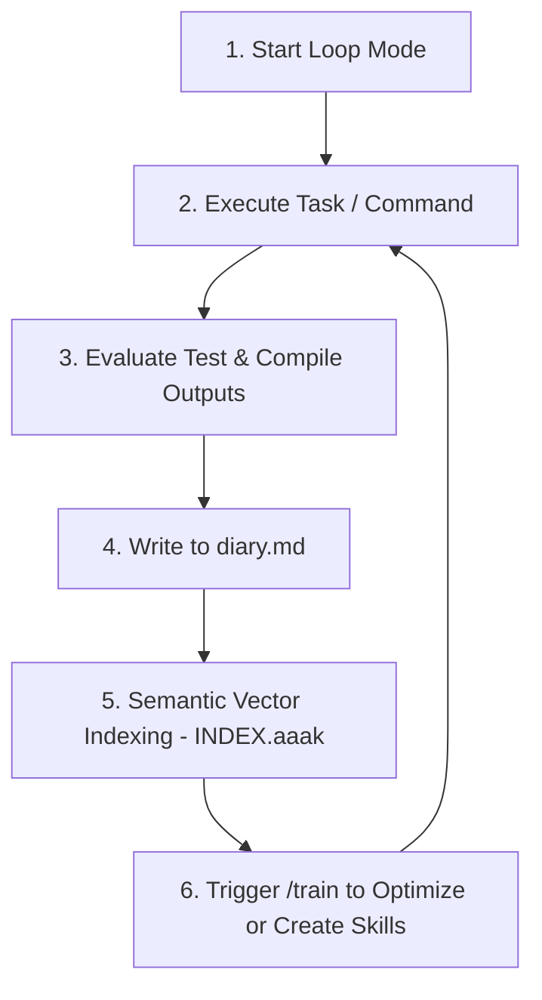

<!-- SPDX-License-Identifier: Apache-2.0 -->
<!-- Copyright (c) 2026 Gothard.dk // Ronni K. Gothard Christiansen -->

# Self-Learning & Autonomic Loops

This guide details the **Self-Learning Loop** architecture in Agent OS Protocol. When running in Loop Mode, agents continuously analyze execution results, compile diaries, index instincts semantically, and generate or optimize developer skills dynamically to achieve higher autonomy and self-improvement.

---

## The Self-Learning Cycle

The self-learning mechanism operates as an autonomic control loop that drives progressive capability enhancement:



---

## 1. Execution Logging & Telemetry
During execution, the runtime captures all agent process inputs, terminal standard streams (stdout/stderr), tool calls, and API responses. 

All activities are serialized to the append-only transaction stream:
* **File location**: `<workspace>/.agent-os/facts.jsonl`
* **Format**: Structured JSON entries documenting each step, inputs, outcomes, and generated tokens.

---

## 2. Success & Failure Appraisal
When a task cycle concludes, a specialized Auditor Agent reviews the results against predefined validation checks:
* **Linting & Compilation**: Evaluates syntax correctness, typescript compiler warnings, and code rules.
* **Test Suite Output**: Measures unit test pass rates and coverage reports.
* **Instruction Fulfillment**: Computes whether the generated outcomes align with the acceptance checklist.

---

## 3. Persistent Agent Diaries (`diary.md`)
Every agent in the fleet maintains an isolated, long-term memory log called a **Diary**.
* **File location**: `agent-os/sub-agents/agents/<agent-name>/diary.md`
* **Contents**:
  * Action histories (sprints completed, files modified).
  * Roadblocks faced and corresponding solutions (e.g. "package X requires import Y in ESM mode").
  * Optimization notes.

This diary is automatically recalled and injected into the agent's context preamble (L1 memory layer) during subsequent turns.

---

## 4. Semantic Instinct Indexing (`INDEX.aaak`)
To prevent diary context bloating, lessons are vectorized and indexed:
* **Tool used**: `agent-os-panel-server` compiles diaries into semantic shards.
* **File location**: `<workspace>/.agent-os/memory/INDEX.aaak`
* **Recall Mechanic**:
  When an agent is loaded to resolve a task, the semantic retrieval bus (L2 memory layer) searches the index for similar context nodes. Prior resolutions are loaded dynamically as "instincts," providing the agent with pre-flight awareness of how to avoid past bugs.

---

## 5. Automated Skill Training (`/train`)
When an agent encounters a recurrent blocker (e.g., three consecutive test suite failures of the same type), the Boss Agent suspends the sprint and invokes a training routine:
1. **Analyze Bug Pattern**: Read compiler outputs and search the web/documentation for the underlying cause.
2. **Draft Training Material**: Generate a new `.md` skill schema in `agent-os/sub-agents/skills/`.
3. **Execute `/train` Command**:
   ```bash
   npm run train -- --skill <new-skill-name>
   ```
4. **Validation**: Run verification checks on the newly trained skill adapter before re-injecting the agent into the main loop.
